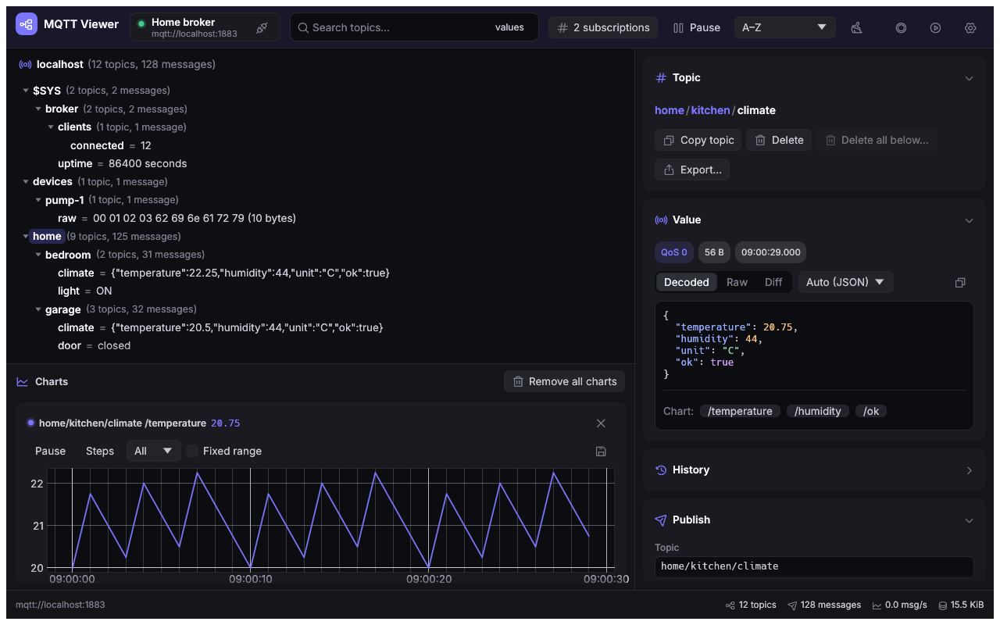
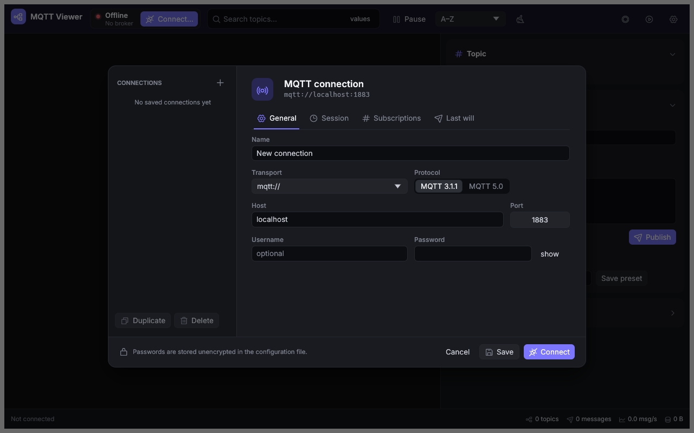
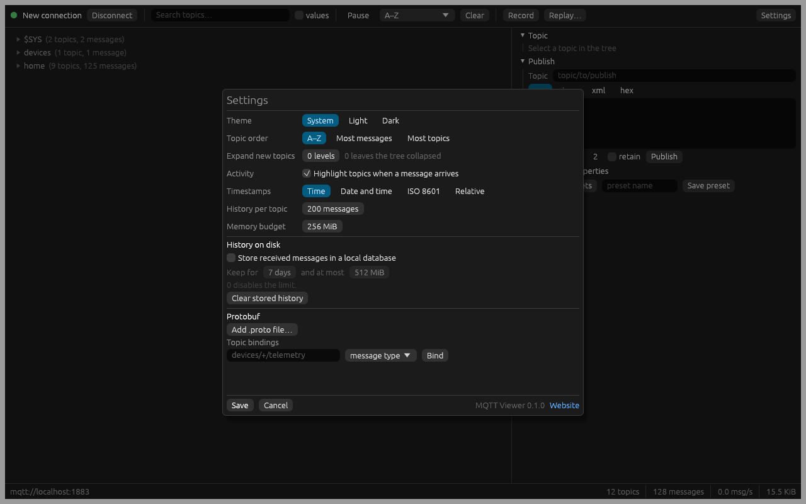

<p align="center"></p>

<h1 align="center">MQTT Viewer</h1>

<p align="center">
  A native MQTT client that shows everything on a broker as a live topic tree.<br>
  macOS, Windows and Linux. No web view, no Electron.
</p>

<p align="center">
  <a href="https://github.com/bircni/mqtt-viewer/actions/workflows/ci.yml"></a>
  <a href="https://github.com/bircni/mqtt-viewer/releases"></a>
  <a href="LICENSE"></a>
</p>



mqtt-viewer connects to a broker, subscribes and lays out every topic as a tree that updates as messages arrive.
It speaks MQTT 3.1.1 and 5, decodes binary payloads and records and replays sessions. It is written in Rust with
[egui](https://github.com/emilk/egui) and stays smooth with 50 000 topics at 5 000 messages per second.

## Features

| | |
|---|---|
| **Topic tree** | Collapsible hierarchy with message and subtopic counts, inline value previews and a flash on activity. Order by name, messages or topics; open new topics automatically down to a chosen depth; pause when it moves too fast. |
| **Search** | Filter by topic and, optionally, by the latest payload. |
| **Keyboard** | Arrow keys, Home and End move through the tree, Space pauses, Delete clears the selected retained message after a confirmation, Ctrl+F (Cmd+F on macOS) jumps to the search. |
| **Values** | Decoded payload with JSON colouring, a raw hex dump, QoS, retain flag, timestamp and size. Diff against the previous message or any message from the history. |
| **Decoders** | Text, JSON, hex, Base64, MessagePack, CBOR, Sparkplug B and Protobuf with your own `.proto` files. Detected automatically, overridable per topic. |
| **Publish** | Raw, JSON, XML or hex payloads with validation, QoS and retain, a list of what you sent and named presets. MQTT 5 user properties, content type, response topic, correlation data and expiry. |
| **Charts** | Plot any numeric topic or any number inside a JSON payload, with a time window, a fixed range, steps or lines. |
| **Record and replay** | Record a session to a file, export a topic, its history or a subtree as JSON or CSV, and replay a recording at any speed, optionally under another topic prefix. |
| **Retained messages** | Delete one, or a whole subtree after a confirmation. |
| **History on disk** | Optionally keep received messages in a local database so they are back after a restart. |
| **Connections** | Saved profiles for `mqtt://`, `mqtts://`, `ws://` and `wss://`, MQTT 3.1.1 and 5, with client certificates, last will, a subscription list and automatic reconnect. |

<p align="center">
  
  
</p>

## Install

Download the file for your platform from the [releases page](https://github.com/bircni/mqtt-viewer/releases).
None of the builds is signed, so each system asks once before it starts the app.

**Windows**: unpack the `.zip` and run `mqtt-viewer.exe`. SmartScreen shows "Windows protected your PC"; choose
**More info**, then **Run anyway**.

**macOS** (Intel and Apple Silicon): open the `.dmg` and drag **MQTT Viewer** to **Applications**. On the first
start macOS refuses to open it; allow it under **System Settings › Privacy & Security › Open Anyway**, or run
`xattr -dr com.apple.quarantine "/Applications/MQTT Viewer.app"`.

**Linux** (x86-64): unpack the `.tar.gz` and run `bin/mqtt-viewer`. To get the menu entry and the icon too,
unpack it into your home directory instead:

```sh
tar -xzf mqtt-viewer-*-x86_64-unknown-linux-gnu.tar.gz -C ~/.local --strip-components=1
```

**From source**, on any platform with a [Rust toolchain](https://rustup.rs):

```sh
git clone https://github.com/bircni/mqtt-viewer
cd mqtt-viewer
cargo run --release -p mqtt-viewer
```

What a source build needs on Linux and Windows is listed in [CONTRIBUTING.md](CONTRIBUTING.md#building).

## Getting started

1. Start the app. The connection dialog opens; enter your broker's host and port and press **Connect**.
2. Topics appear as messages arrive. Click one to see its value, history and statistics on the right.
3. Click a number under **Chart** to plot it, or use the **Publish** panel to send a message to the selected topic.

No broker at hand? The repository ships a small one for testing:

```sh
cargo run -p mqtt-viewer-core --example broker
```

Then connect to `localhost:1883`.

## Configuration

Profiles and settings live in one file:

| Platform | Location |
|---|---|
| macOS | `~/Library/Application Support/bircni.mqtt-viewer/config.toml` |
| Linux | `~/.config/mqtt-viewer/config.toml` |
| Windows | `%APPDATA%\bircni\mqtt-viewer\config\config.toml` |

> [!WARNING]
> Passwords are stored in this file in clear text. On macOS and Linux the file is readable by your user only, but
> anything running as you can read it. Leave the password empty in the profile if that is not acceptable.

Set the environment variable `MQTT_VIEWER_DATA_DIR` to keep the configuration and the optional history database
(`history.sqlite`) in a directory of your choice. A configuration file that cannot be parsed is kept next to the
new one as `config.toml.broken`.

## Contributing

Build instructions, the test setup and the release process are in [CONTRIBUTING.md](CONTRIBUTING.md).

## License

[MIT](LICENSE)
